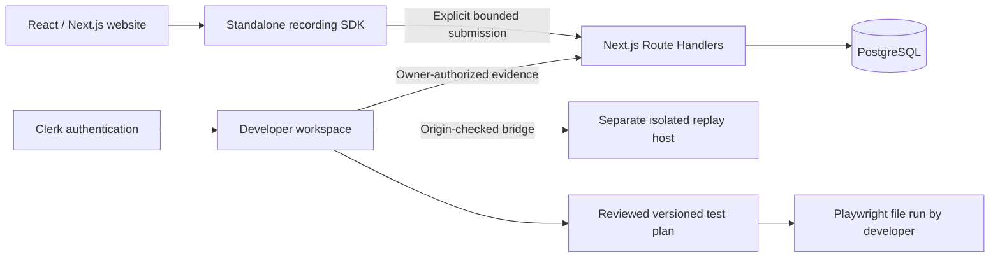

# Unravel

Record a browser bug, inspect its replay and diagnostics, then turn the reviewed evidence into a Playwright regression test.

Unravel is a software engineering portfolio project built with Next.js, TypeScript and PostgreSQL. Its standalone browser SDK works with React and Next.js without bundling either framework.

**Release status:** the bounded local workflow is implemented and verified. The MIT-licensed SDK is published as [`@vansham/unravel-sdk@0.1.0`](https://www.npmjs.com/package/@vansham/unravel-sdk). Public deployment remains pending. [Current status and evidence](docs/PROJECT_STATUS.md)

## What it does

- Explicit visitor-controlled recording through an included floating widget.
- DOM replay alongside readable actions, JavaScript errors and fetch/XHR metadata.
- Authenticated projects and persistent, owner-protected reports.
- Transactional duplicate-submission protection and explicit retry/recovery.
- Editable reproduction plans, developer-confirmed expected outcomes and standalone Playwright exports.

## Architecture



The replay host serves trusted player assets separately from the dashboard. Recorded documents cannot execute recorded scripts or submit forms. The app's server endpoints handle persistence and authorization; there is no separate Express backend or hosted test runner.

| Directory                   | Responsibility                                                           |
| --------------------------- | ------------------------------------------------------------------------ |
| `apps/web`                  | Marketing, authentication, workspace and server endpoints                |
| `packages/sdk`              | Browser recording, diagnostics, privacy choices and reporting widget     |
| `packages/contracts`        | Shared versioned runtime schemas                                         |
| `packages/test-plan`        | Deterministic normalization, review validation and Playwright generation |
| `examples`, `fixtures`      | Independent integrations and controlled bugs                             |
| `prototypes/landing-motion` | Retained original cinematic reference                                    |

## Run locally

Use Node **22.18.0** and pnpm **10.34.9** through Corepack.

```sh
corepack pnpm install --frozen-lockfile
corepack pnpm dev
```

Open **http://localhost:3000**. Root `dev` starts/checks the separate replay player at **http://127.0.0.1:4192**. Use the localhost dashboard address consistently.

Authentication and persistence require your own configured Clerk/PostgreSQL services. Copy `apps/web/.env.example` to `.env.local`, follow [service setup](docs/SERVICE_SETUP.md), review migrations before applying them, and never commit credentials. Missing credentials do not enable an authentication bypass. Marketing can render without those services.

## Interview demo

Open **/demo** on the running application. Prepare your own recording project, then choose the Next.js or standalone React example. Both use the published SDK and the same intentional failures; reports remain private to your account. A **Try the demo** link is available in the workspace.

[Code walkthrough](docs/CODE_WALKTHROUGH.md) · [Demo guide](docs/DEMO_AND_INTERVIEW.md) · [Documentation map](docs/README.md)

## Integrate the SDK

Install the published package in your React or Next.js website:

```sh
npm install @vansham/unravel-sdk@0.1.0
```

The SDK requires a running Unravel service; public application hosting is still pending. Create a project with its exact origin and copy the setup component into that website. Mount the widget once in a browser effect; recording starts only when a visitor chooses Start.

[SDK installation and API](packages/sdk/README.md) · [Manual React/Next examples](examples/README.md) · [Recording and privacy details](docs/SDK.md)

## Important boundaries

- Replay reconstructs a restricted DOM/CSS subset; it is not video or a pixel-perfect copy of arbitrary websites. External images/fonts/stylesheets, canvas, Shadow DOM and cross-origin content have limits. Full document navigation ends capture.
- Masked mode hides field values while retaining ordinary page text. Full-content mode explicitly includes entered and sensitive values where capturable. Rendered text, error messages and paths can contain private information. Both modes exclude network bodies, headers, cookies, hidden inputs and developer-blocked sections.
- Recorded failures do not define correct behavior. Developers review locators, provide safe values and confirm assertions. Exporting a test does not run it or establish correctness.
- Controlled local proof is separate from public deployment, production scale and arbitrary-site compatibility.

## Verification

```sh
corepack pnpm format:check
corepack pnpm lint
corepack pnpm typecheck
corepack pnpm test
corepack pnpm build
corepack pnpm test:sdk
corepack pnpm reference:check
```

Credential-free checks are configured in GitHub Actions. Reports, authentication/database tests and actual exported-test proof use explicitly configured synthetic users/services; they are not silently skipped equivalents of production acceptance. [Complete commands and maintenance guide](docs/DEVELOPMENT_GUIDE.md)

To test the packed artifact in fresh consumers, use `sdk:consumer:prepare` and the [independent-package verification instructions](docs/SDK.md#independent-packed-package-verification).

## Engineering walkthrough and release

- [Repository structure and local-only files](docs/REPOSITORY_MAP.md)
- [Architecture](docs/ARCHITECTURE.md)
- [Reports and replay isolation](docs/REPORTS.md)
- [Reproduction plans and generated tests](docs/TEST_PLANS.md)
- [Demo and interview walkthrough](docs/DEMO_AND_INTERVIEW.md)
- [Completion plan](docs/COMPLETION_PLAN.md)
- [Cleanup review](docs/CLEANUP_REVIEW.md)
- [Release handoff](docs/RELEASE_CHECKLIST.md) and [deployment contract](docs/DEPLOYMENT.md)

## License

Unravel code is [MIT licensed](LICENSE). Bundled dependencies and retained fonts, textures and reference assets retain their own licenses and attribution requirements. See the SDK's [third-party notices](packages/sdk/THIRD_PARTY_NOTICES.txt) and asset provenance files.
