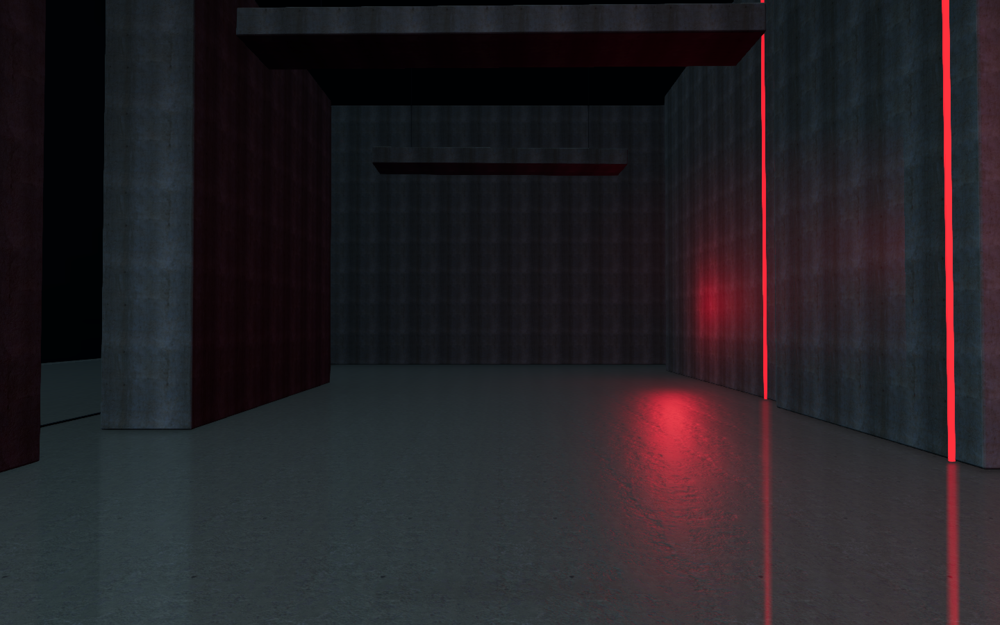
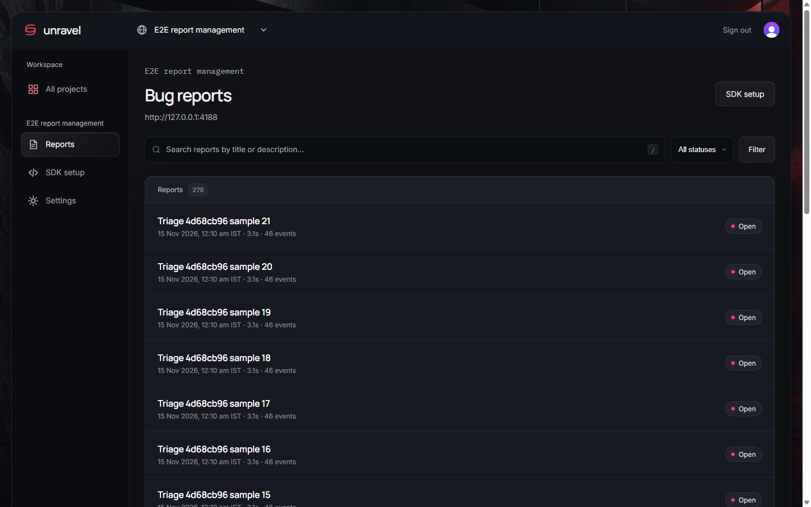
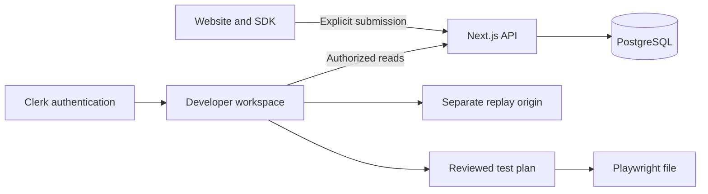

# Unravel

**Record the bug. Understand the sequence. Turn reviewed evidence into a test.**

Unravel connects browser bug reporting, session replay and Playwright test generation. Visitors explicitly record an issue; developers inspect the replay and diagnostics, review reproduction steps and define expected behavior before exporting a test.

[Get started](#run-locally) · [SDK](#integrate-the-sdk) · [Architecture](docs/ARCHITECTURE.md) · [Code tour](docs/knowledge/code-tour.md) · [npm](https://www.npmjs.com/package/@vansham/unravel-sdk)



_Cinematic scene artwork included with the application._

**Status:** `@vansham/unravel-sdk@0.1.0` is published on npm. The supported workflow has been verified locally; public application deployment is pending. There is no hosted application URL yet.

## Why Unravel?

A screenshot shows the result of a bug, but often misses the steps and failed request behind it. Unravel keeps those together so developers can investigate the sequence and turn it into a reviewed test.

- **Explicit recording:** start, reproduce, stop, describe and submit through a floating widget.
- **Two privacy choices:** mask entered field values or explicitly include full content where supported.
- **Private investigation:** owner-protected projects, replay, actions, JavaScript errors and fetch/XHR metadata.
- **Recovery:** unchanged submission retries and revision checks for competing edits.
- **Reviewed test generation:** editable plans and standalone Playwright reproduction/regression exports.
- **React and Next.js demos:** controlled failures using the published SDK, plus independent integration examples.



_Captured during earlier local verification with synthetic test data. Report counts are fixture data, not usage analytics._

## How it works



The SDK gathers DOM replay evidence and a separate stream of actions/diagnostics. The backend validates and stores them. An isolated player reconstructs supported page changes with recorded scripts disabled. A deterministic generator proposes steps; the developer reviews targets, safe values and assertions. Exported tests run in the developer's environment, not on an Unravel cloud runner.

## Tech stack

| Area                             | Tools                                             |
| -------------------------------- | ------------------------------------------------- |
| Application and API              | Next.js App Router, React, TypeScript             |
| Identity                         | Clerk                                             |
| Database                         | PostgreSQL, Drizzle, node-postgres                |
| Capture and validation           | rrweb, Zod, custom browser instrumentation        |
| Test generation and verification | Deterministic TypeScript generator, Playwright    |
| Interface and graphics           | Three.js, GSAP, Motion, CodeMirror                |
| Repository tooling               | pnpm workspaces, ESLint, Prettier, GitHub Actions |

See the [knowledge handbook](docs/knowledge/README.md) for design choices and tradeoffs.

## Run locally

### 1. Requirements

- **Node.js 22.18.0** and **pnpm 10.34.9** through Corepack.
- Git and network access for installation.
- Your own **Clerk development application** and **PostgreSQL database** for sign-in, projects and saved reports.

Landing and demo interactions can be explored without credentials. The complete recording-to-report workflow requires the services below. Docker is not required.

### 2. Clone and install

```sh
git clone https://github.com/vanshambansal/Unravel.git
cd Unravel
corepack pnpm install --frozen-lockfile
```

If `corepack` is unavailable, install or enable Corepack for your Node installation. Use the pinned toolchain versions.

### 3. Configure your services

macOS/Linux:

```sh
cp apps/web/.env.example apps/web/.env.local
```

Windows PowerShell:

```powershell
Copy-Item apps/web/.env.example apps/web/.env.local
```

Fill in your own settings in `apps/web/.env.local`:

| Variable                            | Purpose                                              |
| ----------------------------------- | ---------------------------------------------------- |
| `NEXT_PUBLIC_CLERK_PUBLISHABLE_KEY` | Browser key from your Clerk development application. |
| `CLERK_SECRET_KEY`                  | Server key from the same Clerk application.          |
| `DATABASE_URL`                      | Application connection to your PostgreSQL database.  |
| `DATABASE_MIGRATION_URL`            | Direct migration connection to the same database.    |

Configure Clerk for `http://localhost:3000`, keeping the template's sign-in/sign-up routes. Use an empty database you are authorized to initialize and your provider's required TLS settings. A pooled application connection and direct migration connection can target the same database.

Keep other local defaults and public-ingestion safeguards unchanged. Test-only credentials are unnecessary for normal startup. Never commit real environment files. [Complete service configuration](docs/SETUP.md#configure-your-services) explains optional and production settings.

### 4. Initialize and start

```sh
corepack pnpm db:migrate
corepack pnpm db:check
corepack pnpm dev
```

Open **http://localhost:3000**. The command builds shared packages, player assets and the React demo, then starts both processes:

| Process                | Default URL             |
| ---------------------- | ----------------------- |
| Application            | `http://localhost:3000` |
| Isolated replay player | `http://127.0.0.1:4192` |

Both must remain available for replay. The separate player origin is intentional. See [startup configuration](docs/SETUP.md#run-the-complete-application) for alternate ports.

Committed migrations live in `apps/web/drizzle`; do not generate new migrations for initial setup. `db:check` verifies connectivity and all six application tables.

## Try the complete workflow

1. Sign in and open **`/demo`**. Prepare your own project for the current origin.
2. Choose React or Next.js and start the reporter. Select a privacy mode.
3. Reproduce the intentional question-submission failure using synthetic values.
4. Stop, describe and submit. The example's failed request is intentional; the report upload should succeed.
5. Open the saved report and inspect replay, actions, requests and errors.
6. Review the proposed plan, replace masked values with safe data and confirm intended assertions for regression mode.
7. Download Playwright and execute it in the target project's configured Playwright environment.

A useful regression demonstration runs the same reviewed test against the buggy target and its fixed behavior: fail at the intended assertion before the fix, pass afterward. Export alone does not prove correctness.

## Integrate the SDK

In another React or Next.js project:

```sh
npm install @vansham/unravel-sdk@0.1.0
```

Register the website's exact origin in your running Unravel instance and copy its public project ID. Mount this component once:

```tsx
'use client'; // Needed for this component in Next.js App Router.
import { useEffect } from 'react';
import { mountWidget } from '@vansham/unravel-sdk';

export function UnravelReporter() {
  useEffect(() => {
    const widget = mountWidget({
      projectId: 'YOUR_PUBLIC_PROJECT_ID',
      applicationOrigin: 'http://localhost:3000',
    });
    return () => widget.destroy();
  }, []);
  return null;
}
```

React: render `<UnravelReporter />` in your root application. Next.js: save it in a client component file and render it from `app/layout.tsx`. `applicationOrigin` points to Unravel, not the recorded website. Mounting does not start capture; visitors choose Start and need no Unravel account.

Read the [SDK API, privacy policy and limits](packages/sdk/README.md) and [independent React/Next examples](examples/README.md).

## Repository structure

```text
apps/web/           Main application, API, migrations and runtime assets
packages/sdk/       Browser recorder and visitor widget
packages/contracts/ Shared runtime schemas
packages/test-plan/ Plan processing and Playwright generation
examples/           Independent integrations and standalone React demo
fixtures/           Controlled websites with intentional failures
tests/              Unit, SDK and browser checks
scripts/            Build, replay hosting, release and verification tools
docs/               Setup, architecture and knowledge handbook
```

The [guided code tour](docs/knowledge/code-tour.md) explains major files, routing and three complete request journeys.

## Development and testing

| Command                      | Purpose                                            |
| ---------------------------- | -------------------------------------------------- |
| `corepack pnpm format:check` | Check maintained source formatting.                |
| `corepack pnpm lint`         | Run lint rules.                                    |
| `corepack pnpm typecheck`    | Build shared packages and check types.             |
| `corepack pnpm test`         | Run unit tests.                                    |
| `corepack pnpm build`        | Build packages, replay assets and application.     |
| `corepack pnpm test:sdk`     | Run SDK browser checks after browser installation. |

Install browser binaries with `corepack pnpm exec playwright install chromium firefox`. Service-dependent suites require dedicated configuration: read [verification instructions](docs/SETUP.md#verification) before running them. Never point destructive tests at your application database.

For a local production-mode preview, follow [build/startup instructions](docs/SETUP.md#build-and-run-in-production-mode-locally), including the separate player and loopback-ingestion setting.

## Privacy, limitations and readiness

- Masked mode hides field values but keeps ordinary page text, including echoed values. Explicit full-content mode can include sensitive entered values where supported.
- Both modes exclude hidden inputs, blocked sections, SDK UI, network bodies/headers/cookies and URL queries/fragments. Bounded diagnostic messages and URL paths remain visible. Use synthetic demo data.
- Replay is a restricted DOM/CSS reconstruction, not video or universal visual fidelity. External resources, canvas, Shadow DOM, complex controls and full-document navigation have limitations.
- Generation is deterministic, without LLM inference of business intent. Developers review locators and expected results; exporting does not run or certify a test.
- Configured local workflows and credential-free clean-checkout checks have passed. Separate fresh-service acceptance and public hosting remain pending. See [dated verification scope](docs/knowledge/engineering-decisions.md#what-has-actually-been-verified).

Public hosting also requires separate HTTPS origins, production Clerk/database settings, signed account-deletion webhook verification, actual intake protection and retention/privacy decisions. Acknowledgement flags do not implement those controls. See [deployment boundaries](docs/SETUP.md).

## Troubleshooting

| Symptom                              | First check                                                            |
| ------------------------------------ | ---------------------------------------------------------------------- |
| Sign-in or saved reports unavailable | Configure Clerk/database settings and restart.                         |
| Database check fails                 | Check database targets, TLS and completed migrations.                  |
| Replay unavailable                   | Keep the separate player running; check its origin and allowed parent. |
| External example widget absent       | Check example environment settings and reporter mounting.              |
| Submission rejected                  | Check the registered scheme/hostname/port and size/limit feedback.     |

## Documentation and contributions

- [Setup](docs/SETUP.md): services, migrations and test configuration.
- [Architecture](docs/ARCHITECTURE.md): boundaries and data flow.
- [Knowledge handbook](docs/knowledge/README.md): implementation and interview preparation.
- [Portable briefing](docs/knowledge/project-context.md): self-contained project summary.
- [SDK documentation](packages/sdk/README.md): public integration contract.

For bug reports, include reproducible steps, expected/actual behavior and environment details using synthetic data. Keep changes focused, run relevant checks and update documentation when behavior changes. Never attach credentials or private recordings to public issues.

## License

Unravel code is [MIT licensed](LICENSE). Dependencies and assets retain their licenses: [SDK notices](packages/sdk/THIRD_PARTY_NOTICES.txt), [texture provenance](apps/web/public/landing/licenses/texture-provenance.json), [font licenses](apps/web/public/landing/fonts) and [additional asset notices](apps/web/public/landing/licenses).
