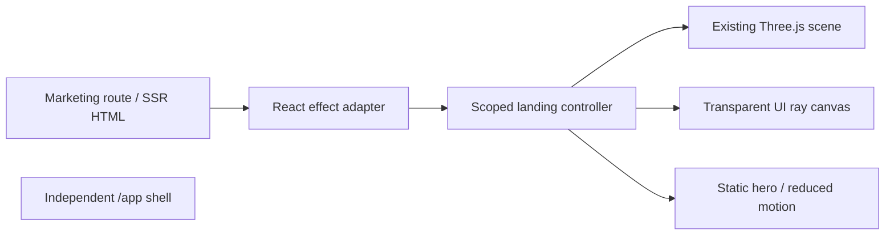

# Architecture

Updated 2026-11-10. This document describes the implemented foundation separately from approved future product architecture.

## Implemented

One Next.js App Router application under apps/web. The marketing route renders useful HTML, local fonts, poster artwork and accessible controls before graphics initialize. A small client component dynamically imports the controller from an effect. The controller receives its own root element and returns an idempotent cleanup function.

Scene construction, asset loading, camera choreography, canonical desktop/mobile framing, quality guard and UI ray shader stay as separate modules. The scene exposes async initialization, progress, resize, pause, quality reduction, render, metrics and dispose. No React Three Fiber or separate backend process is used. Milestone 2 now adds the authentication/project boundaries below.

## Lifecycle and isolation

- DOM lookup, inline state and render/static classes are scoped to the landing root. CSS selectors and font names are namespaced; body receives only a small neutral reset.
- Cancelled React effects do not mount the controller. Its generation ticket disposes late async scene results after unmount/preference changes. Font-readiness callbacks check disposal.
- Cleanup cancels owned animation frames, kills the owned ScrollTrigger, disconnects observers, removes named listeners, disposes scene/ray resources, restores manipulated DOM attributes and removes owned debug hooks.
- The development/test-only window.__unravelStudy bridge is removed on unmount. A root-local read-only snapshot supports inspection. There is no privileged product API.
- The renderer/ray modules load only from the marketing lifecycle. The /app workspace uses a separate route group and does not prefetch the cinematic route. Authentication and workspace providers load only on product/authentication routes.
- Skip focuses the heading; pause freezes ambient/ray motion while scroll remains usable. Rendering stops when hidden or less than 1% of the stage intersects the viewport, avoiding fractional-pixel slivers at section boundaries.

## Assets and maintenance

GLB, baked indirect/AO maps, fonts/licenses, mark and four renderer-derived posters are copied under public/landing. The runtime importer retains the approved strip-coverage correction. The original prototype is unchanged and excluded from the pnpm workspace.

The maintenance capture route runs the real application renderer at time zero and is unavailable in ordinary production. Poster hashes detect stale source/assets. Capture/parser scripts run through installed Playwright, independently of MCP.

The Blender source/builder still targets the original prototype's asset directory. Do not retire the reference or rerun its builder casually: repoint and verify authored texture/output paths in a separate asset-maintenance task first. No scene rebuild or asset redesign was part of this migration.

## Product boundaries - current and future

- Implemented: Next.js Node Route Handlers call modular validation, authorization and persistence services. No separate Express process.
- Implemented: Clerk authenticates developers and Unravel authorizes every project operation. Future report operations must follow the same ownership boundary; visitors will report without an account.
- Implemented: Neon PostgreSQL with Drizzle/node-postgres and reviewed project migrations. Future replay payloads must be bounded and separately retrieved; report lists must not fetch replay blobs.
- Planned: standalone TypeScript SDK, versioned shared runtime contracts, rrweb capture/replay and safe telemetry. Create packages only as needed.
- Planned: framework-independent versioned JSON test plans with deterministic generation; expected assertions require developer confirmation. Playwright is the first export adapter, executed locally.
- Public deployment requires authorization, ingestion protections, privacy review and measured hosting/payload limits. No LLM or hosted test execution is assumed.

## Verification ownership

Pure behavior uses Node's test runner. Repository Playwright tests cover real browser behavior, fallbacks and lifecycle isolation; manual/browser visual inspection checks aesthetic parity. Performance numbers are browser/GPU-specific. Commands belong in the root README and current outcomes in PROJECT_STATUS.md.

## Milestone 2 implementation and verified boundaries

- Canonical local application origin is http://localhost:3000 for matching Next.js/Clerk rewrite and cookie origins; the original Vite fixture/reference remains independent.
- Authentication routes /sign-in and /sign-up use Clerk components with a scoped provider and dark product styles. Next.js 16 proxy.ts authenticates only product/auth/project-API requests, leaving marketing graphics isolated. No keyless fallback application is provisioned when configuration is absent.
- /app redirects to /app/projects. The product layout and data-reading pages check the developer session; private APIs independently authenticate every request. Missing configuration fails closed; no test/preview identity bypass exists.
- Thin /api/projects and /api/projects/[projectId] handlers call server auth and project services. Validation is shared with the form; the server never trusts owner IDs from a body or route. All repository reads constrain both owner and project ID, with foreign/missing projects returning the same 404.
- A project stores UUID, stable Clerk subject, name, normalized website origin and creation time. No local password/email/account synchronization or webhook is needed. Initial convention: one owner and one website origin per project; the same owner cannot duplicate an origin, while independent owners may register it. Domain registration is not domain ownership verification.
- PostgreSQL is lazy-connected through a small node-postgres pool and Drizzle. No connection at module import/build, no automatic migration at server startup. SQL migration creates the table, owner index and owner/origin uniqueness constraint. No report tables yet.
- Registration accepts a domain or full HTTP(S) URL, defaults bare domains to HTTPS, rejects embedded credentials/unsafe schemes, and previews the exact stored origin. Paths/query/fragment are discarded. The server does not fetch submitted URLs. Creation leads to /app/projects/[id]/setup with honest SDK-unavailable guidance.
- Writes require same-origin JSON and an 8 KiB bounded body. Provider authentication is separate from project ownership. Database/unknown failures return generic errors without connection strings. Public anonymous report-ingestion controls are a later milestone.
- Real PostgreSQL tests require an isolated TEST_DATABASE_URL and refuse the app database. Real-session browser tests use two existing synthetic Clerk development users; they do not prove first-factor delivery or OAuth. See SERVICE_SETUP.md for manual flow verification.
