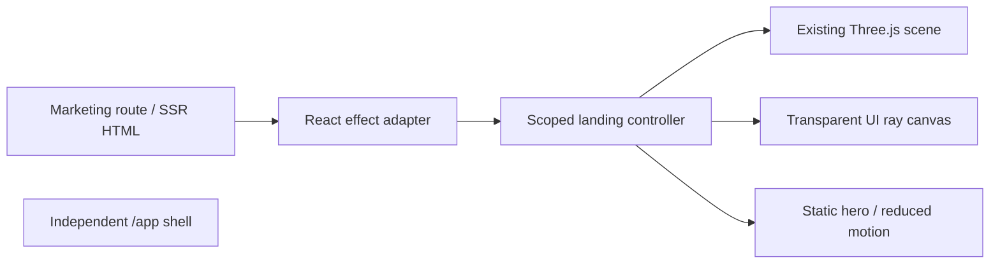

# Architecture

Updated 2026-11-10. This document describes the implemented foundation separately from approved future product architecture.

## Implemented

One Next.js App Router application under apps/web. The marketing route renders useful HTML, local fonts, poster artwork and accessible controls before graphics initialize. A small client component dynamically imports the controller from an effect. The controller receives its own root element and returns an idempotent cleanup function.

Scene construction, asset loading, camera choreography, canonical desktop/mobile framing, quality guard and UI ray shader stay as separate modules. The scene exposes async initialization, progress, resize, pause, quality reduction, render, metrics and dispose. No React Three Fiber, backend service or authentication dependency is installed.

## Lifecycle and isolation

- DOM lookup, inline state and render/static classes are scoped to the landing root. CSS selectors and font names are namespaced; body receives only a small neutral reset.
- Cancelled React effects do not mount the controller. Its generation ticket disposes late async scene results after unmount/preference changes. Font-readiness callbacks check disposal.
- Cleanup cancels owned animation frames, kills the owned ScrollTrigger, disconnects observers, removes named listeners, disposes scene/ray resources, restores manipulated DOM attributes and removes owned debug hooks.
- The development/test-only window.__unravelStudy bridge is removed on unmount. A root-local read-only snapshot supports inspection. There is no privileged product API.
- The renderer/ray modules load only from the marketing lifecycle. The /app shell uses a separate route group and does not prefetch the cinematic route. It exposes no data or account features.
- Skip focuses the heading; pause freezes ambient/ray motion while scroll remains usable. Rendering stops when hidden or less than 1% of the stage intersects the viewport, avoiding fractional-pixel slivers at section boundaries.

## Assets and maintenance

GLB, baked indirect/AO maps, fonts/licenses, mark and four renderer-derived posters are copied under public/landing. The runtime importer retains the approved strip-coverage correction. The original prototype is unchanged and excluded from the pnpm workspace.

The maintenance capture route runs the real application renderer at time zero and is unavailable in ordinary production. Poster hashes detect stale source/assets. Capture/parser scripts run through installed Playwright, independently of MCP.

The Blender source/builder still targets the original prototype's asset directory. Do not retire the reference or rerun its builder casually: repoint and verify authored texture/output paths in a separate asset-maintenance task first. No scene rebuild or asset redesign was part of this migration.

## Approved future boundaries - not implemented

- Next.js Node Route Handlers call modular validation, authorization and persistence services. No separate Express process initially.
- Clerk authenticates developers; Unravel must authorize every project/report operation. Visitors report without an Unravel account.
- Neon PostgreSQL with Drizzle/node-postgres, reviewed migrations and separately retrieved bounded replay payloads. Report lists must not fetch replay blobs.
- Standalone TypeScript SDK, versioned shared runtime contracts, rrweb capture/replay and safe telemetry. Create packages only as needed.
- Framework-independent versioned JSON test plans with deterministic generation; expected assertions require developer confirmation. Playwright is the first export adapter, executed locally.
- Public deployment requires authorization, ingestion protections, privacy review and measured hosting/payload limits. No LLM or hosted test execution is assumed.

## Verification ownership

Pure behavior uses Node's test runner. Repository Playwright tests cover real browser behavior, fallbacks and lifecycle isolation; manual/browser visual inspection checks aesthetic parity. Performance numbers are browser/GPU-specific. Commands belong in the root README and current outcomes in PROJECT_STATUS.md.
