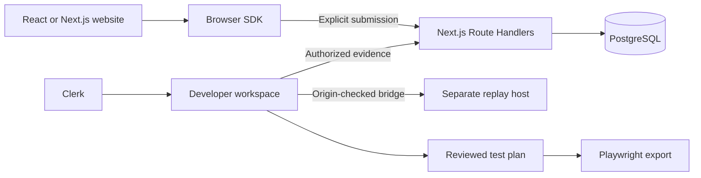

# Architecture

Unravel records an explicitly started browser interaction, stores a private report, reconstructs its replay and generates a developer-reviewed Playwright test.

## Responsibilities

| Location | Responsibility |
| --- | --- |
| `apps/web/src/app` | Landing, authentication, dashboard, demos and HTTP endpoints. |
| `apps/web/src/features` | Feature UI and browser-side behavior. |
| `apps/web/src/server` | Authentication, validation, services, repositories and database schema. |
| `apps/web/drizzle` | Committed SQL migrations and Drizzle metadata. |
| `packages/sdk` | Framework-independent recorder, privacy, diagnostics and reporting widget. |
| `packages/contracts` | Versioned runtime schemas shared by SDK and server. |
| `packages/test-plan` | Action normalization, editable plan validation and Playwright generation. |
| `examples` and `fixtures` | Independent installations and controlled test applications. |
| `tests`, `apps/web/tests`, `scripts` | Automated checks and reproducible maintenance tools. |

The backend is part of Next.js; there is no separate Express application or cloud test runner. Clerk identifies developers. Every private project/report operation checks ownership in the server/repository layer.

## Recording and persistence

The SDK starts only after the visitor chooses Start. DOM changes support replay; semantic actions, errors, navigation and fetch/XHR metadata form a correlated timeline. Capture has duration, event-count and payload limits.

Masked mode hides field values while preserving ordinary displayed text. Full-content mode explicitly includes entered and sensitive values where supported. Both exclude hidden inputs, SDK UI, blocked sections, network bodies, headers, cookies and URL queries/fragments. See the [SDK API and policy](../packages/sdk/README.md).

The server treats submissions as untrusted. It independently validates bounded inert evidence before storage. Reports and payloads are stored separately so list queries do not load replay data. Recording identity plus a canonical digest makes retry idempotent; changing an already-attempted envelope conflicts. Registered origins/CORS are not authentication or complete abuse protection.

## Replay isolation

`scripts/replay-host.mjs` serves fixed trusted player assets on an origin different from the dashboard. Parent/player messages validate exact origins, source windows and a channel identifier. The inner recorded-document frame cannot execute recorded scripts or submit forms. Never move the player onto the dashboard origin or give it database/Clerk credentials.

Replay reconstructs a restricted DOM/CSS subset. It is not video or universal visual equivalence. External assets, canvas, Shadow DOM, complex controls and full-document navigation have limitations.

## Test generation

The generator deterministically folds observed actions into an editable plan while keeping original evidence immutable. Developers review locators, replace masked input with safe test values and confirm intended outcomes. Export produces a standalone Playwright file; it does not execute or certify the test. A recorded HTTP500 does not establish correct behavior.

## Demonstration and local services

`/demo/next` is a Next route. `/demo/react` serves an independently built React document without a Next runtime. Both use the published SDK through an explicit npm alias and can submit into the signed-in owner's registered project. Their shared scenario UI contains intentional synthetic failures.

The production SDK remains independent of these demos. Separate React/Next example packages install it from npm. Normal build commands generate SDK, player and React demo bundles; generated artifacts are not committed. Follow [local setup](SETUP.md) to run the complete application.
