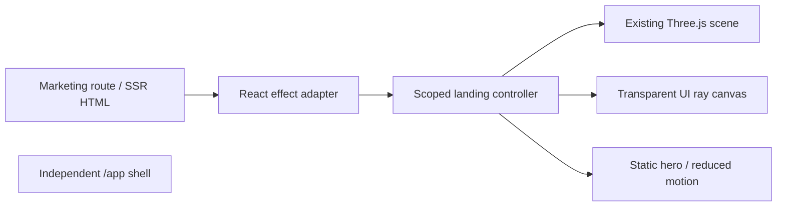

# Architecture

Updated 2026-11-11. This document describes the implemented foundation separately from approved future product architecture.

## Implemented

One Next.js App Router application under apps/web. The marketing route renders useful HTML, local fonts, poster artwork and accessible controls before graphics initialize. A small client component dynamically imports the controller from an effect. The controller receives its own root element and returns an idempotent cleanup function.

Scene construction, asset loading, camera choreography, canonical desktop/mobile framing, quality guard and UI ray shader stay as separate modules. The scene exposes async initialization, progress, resize, pause, quality reduction, render, metrics and dispose. No React Three Fiber or separate backend process is used. Milestone 2 now adds the authentication/project boundaries below.

## Lifecycle and isolation

- DOM lookup, inline state and render/static classes are scoped to the landing root. CSS selectors and font names are namespaced; body receives only a small neutral reset.
- Cancelled React effects do not mount the controller. Its generation ticket disposes late async scene results after unmount/preference changes. Font-readiness callbacks check disposal.
- Cleanup cancels owned animation frames, kills the owned ScrollTrigger, disconnects observers, removes named listeners, disposes scene/ray resources, restores manipulated DOM attributes and removes owned debug hooks.
- The development/test-only window.__unravelStudy bridge is removed on unmount. A root-local read-only snapshot supports inspection. There is no privileged product API.
- The renderer/ray modules load only from the marketing lifecycle. The /app workspace uses a separate route group and does not prefetch the cinematic route. Authentication and workspace providers load only on product/authentication routes.
- Skip focuses the heading; pause freezes ambient/ray motion while scroll remains usable. Rendering stops when hidden or less than 1% of the stage intersects the viewport, avoiding fractional-pixel slivers at section boundaries.

## Assets and maintenance

GLB, baked indirect/AO maps, fonts/licenses, mark and four renderer-derived posters are copied under public/landing. The runtime importer retains the approved strip-coverage correction. The original prototype is unchanged and excluded from the pnpm workspace.

The maintenance capture route runs the real application renderer at time zero and is unavailable in ordinary production. Poster hashes detect stale source/assets. Capture/parser scripts run through installed Playwright, independently of MCP.

The Blender source/builder still targets the original prototype's asset directory. Do not retire the reference or rerun its builder casually: repoint and verify authored texture/output paths in a separate asset-maintenance task first. No scene rebuild or asset redesign was part of this migration.

## Product boundaries - current and future

- Implemented: Next.js Node Route Handlers call modular validation, authorization and persistence services. No separate Express process.
- Implemented: Clerk authenticates developers and Unravel authorizes every project/report operation. Visitors submit without an account.
- Implemented: Neon PostgreSQL with Drizzle/node-postgres and reviewed project/report migrations. Bounded replay payloads are stored/retrieved separately; report lists do not fetch replay blobs.
- Implemented: standalone TypeScript SDK and versioned runtime contracts for sanitized recording/semantic telemetry, explicit submission and masked structural playback. See SDK.md and REPORTS.md for privacy/fidelity limits.
- Implemented locally: framework-independent versioned JSON test plans with deterministic generation; expected assertions require developer confirmation. Playwright is the first export adapter, executed locally.
- Public deployment requires authorization, ingestion protections, privacy review and measured hosting/payload limits. No LLM or hosted test execution is assumed.

## Verification ownership

Pure behavior uses Node's test runner. Repository Playwright tests cover real browser behavior, fallbacks and lifecycle isolation; manual/browser visual inspection checks aesthetic parity. Performance numbers are browser/GPU-specific. Commands belong in the root README and current outcomes in PROJECT_STATUS.md.

## Milestone 2 implementation and verified boundaries

- Canonical local application origin is http://localhost:3000 for matching Next.js/Clerk rewrite and cookie origins; the original Vite fixture/reference remains independent.
- Authentication routes /sign-in and /sign-up use Clerk components with a scoped provider and dark product styles. Next.js 16 proxy.ts authenticates only product/auth/project-API requests, leaving marketing graphics isolated. No keyless fallback application is provisioned when configuration is absent.
- /app redirects to /app/projects. The product layout and data-reading pages check the developer session; private APIs independently authenticate every request. Missing configuration fails closed; no test/preview identity bypass exists.
- Thin /api/projects and /api/projects/[projectId] handlers call server auth and project services. Validation is shared with the form; the server never trusts owner IDs from a body or route. All repository reads constrain both owner and project ID, with foreign/missing projects returning the same 404.
- A project stores UUID, stable Clerk subject, name, normalized website origin and creation time. No local password/email/account synchronization or webhook is needed. Initial convention: one owner and one website origin per project; the same owner cannot duplicate an origin, while independent owners may register it. Domain registration is not domain ownership verification.
- PostgreSQL is lazy-connected through a small node-postgres pool and Drizzle. No connection at module import/build, no automatic migration at server startup. The initial SQL creates projects, owner index and owner/origin uniqueness; Milestone 4 adds reports/payloads through an additive migration.
- Registration accepts a domain or full HTTP(S) URL, defaults bare domains to HTTPS, rejects embedded credentials/unsafe schemes, and previews the exact stored origin. Paths/query/fragment are discarded. The server does not fetch submitted URLs. Creation leads to /app/projects/[id]/setup with actual local SDK/submission instructions and a report-list link.
- Writes require same-origin JSON and an 8 KiB bounded body. Provider authentication is separate from project ownership. Database/unknown failures return generic errors without connection strings. Public anonymous report-ingestion controls are a later milestone.
- Real PostgreSQL tests require an isolated TEST_DATABASE_URL and refuse the app database. Real-session browser tests use two existing synthetic Clerk development users; they do not prove first-factor delivery or OAuth. See SERVICE_SETUP.md for manual flow verification.

## Milestone 3 recording boundary

`packages/contracts` owns versioned runtime schemas/types using Zod Mini. `packages/sdk` has no framework dependency: initialize creates a controller; explicit Start dynamically loads @rrweb/record and installs owned action/error/navigation/fetch/XHR observers. Each event is rebuilt/sanitized before entering bounded in-memory arrays. Stop and Destroy dispose owned resources and invalidate pending work; recorded data is never automatically uploaded or persisted.

The separate fixture serves the SDK's standalone script, while a development-only Next.js client harness consumes its ESM entry. A test-built plain React Strict Mode harness proves the same package independently of Next. Marketing/auth/project pages do not initialize the SDK; setup displays source instructions without importing the recording engine. No playback library is added to the browser recorder.

Native form interactions use explicitly allowlisted test IDs or bounded content-free structural paths; unsupported targets remain unresolved. Conservative reconstruction omits arbitrary DOM attributes/CSS/resource bodies; this limits fidelity intentionally. See SDK.md for exact policy, provisional limits and lifecycle. Milestone 4 must treat clients/payloads as untrusted, validate independently, and establish replay sandbox/resource policy before displaying recorded content. SDK masking is not server authorization or proof that arbitrary submitted data is safe.

## Milestone 4 implementation

The preferred integration is SDK `mountWidget`: a framework-independent Shadow DOM launcher/panel delegates to the existing recorder and submission controller. It owns explicit recording, report details, unchanged retry and teardown; no React runtime is required. The widget host and descendants are excluded from replay/actions even across shadow boundaries. The local package contains its declarations and bundled shared contracts; see SDK.md for packing/installing. The application uses a compact project switcher, real setup instructions and an integrated responsive replay/evidence view; neither product routes nor the widget import marketing graphics. Bare loopback registrations default to HTTP; public bare domains still default to HTTPS. Existing registrations are not rewritten.

Explicit SDK submission sends a bounded versioned envelope after Stop, without credentials. Requests require the exact registered Origin and local/public deployment gates; public admission is off by default. Shared database quotas/deadlines supplement, rather than replace, required edge controls. This is not visitor authentication. Thin handlers call validation/services/repositories. A transaction stores report metadata plus a separate immutable replay/event payload. A project/recording uniqueness constraint and canonical SHA-256 digest distinguish identical retries from conflicting reuse. Private detail/replay/delete operations constrain project owner independently on the server. Owner deletion cascades to the payload; no automatic expiry is selected for local development.

Deep server validation reconstructs an inert replay subset and removes original resource references. Report lists never retrieve payloads. The authenticated page fetches replay separately and sends it only to the configured isolated player origin. Its source/origin/channel-checked bridge controls playback/seek/fit; timing acknowledgements report actual player position. Original recorded DOM stays in rrweb's script-disabled iframe. The user-approved separate loopback server serves only trusted HTML/JS/CSS, with an explicit parent-origin allowlist and strict resource-blocking CSP; it has no private API/database access. Same-origin hosting is refused. The earlier opaque-origin failure and rejected same-origin permission proposal remain historical; the isolated implementation passed browser DOM-access, script/resource and unauthorized-embedding checks. See REPORTS.md for operation and PROJECT_STATUS.md for actual results and limits.

## Project management

Owner-scoped PATCH/DELETE on `/api/projects/[projectId]` reuse the bounded same-origin JSON boundary. PATCH validates the same name/origin rules as registration and maps the owner/origin unique constraint to a field conflict. Both operations require the last-read name/origin snapshot and include it in the SQL write predicate; a concurrent change cannot be overwritten. DELETE also requires the exact current project name. The existing project/report/payload foreign-key cascade is reused; no schema migration is needed. Existing report evidence retains its recorded origin. Missing/foreign projects return the same 404; stale snapshots return 409. Origin changes affect subsequent ingestion validation, not immutable historical recordings. No account, provider or ingestion-trust model changed.

## Internal presentation boundary

Workspace composition components own repeatable page/group/row/footer/list/dialog markup and scoped CSS. Product feature modules retain state, validation, API calls and replay refs/bridge ownership. Navigation and account controls stay in the workspace shell. The standalone SDK retains its separate Shadow DOM presentation and no React dependency. See INTERNAL_UI.md for usage; do not import product presentation into marketing or recording packages.

## Styled replay and regression boundary

Presentation-v1 recording captures a closed computed-style vocabulary; shared contract functions validate every inline declaration again on ingestion. Resource-loading CSS, generated content and original stylesheet bodies remain excluded. Legacy recordings remain readable without presentation. Replay stays on the same isolated local origin with scripts/resources disabled.

`packages/test-plan` is pure schema/normalization/prose/adapter logic. Thin private plan/export handlers authorize report ownership before loading or writing. The separate report_test_plans table stores one mutable plan with an optimistic revision; report evidence remains immutable. The editor and JSON operate on the same plan and require safe replacements for masked values. Reproduction validates included actions; regression additionally requires confirmed expected outcomes. Unapplied/invalid data blocks Playwright export, which saves a valid dirty draft before downloading. Server export validates stored data and returns escaped Playwright source; it never executes supplied code. Controlled local proof uses the actual downloaded file against buggy/fixed fixture source versions. Operation and limitations are owned by TEST_PLANS.md.

## Design-tool context and exploration boundary

apps/web/PRODUCT.md is a small design-tool context entry point linking to the authoritative project brief/status. Native Figma authoring helpers and the current exploration ledger live under design/figma; they are not application modules or a second frontend. A/B styles/components are isolated from prior Figma masters. No runtime architecture or privacy boundary changes during the design-only exploration.

## Internal presentation runtime

The approved B authentication and A workspace use existing architectural artwork, CSS material light and web-only Motion transitions. WorkspaceMotion owns ambient pause, visibility and reduced-motion policy. The landing Three.js/GSAP renderer remains marketing-only. The server product layout passes authorized project metadata into persistent navigation; there is no client ownership bypass.

Recorder state and recording/submission services remain independent of widget presentation. One persistent Shadow DOM material shell uses native Web Animations; its listeners/animations clean up through the widget AbortController. Investigation motion preserves the player while selecting evidence, but view exit still removes it immediately. Plan draft state remains mounted after first opening.

## Review-first plan boundary - 2026-11-11

The pure test-plan package reads version 1 or 2 and outputs normalized version 2, without database writes. PlanEditor/PlanControls edit that draft; save still uses the existing private revision-checked JSONB boundary. Export mode is reproduction or regression: included action validation applies to both, while confirmed typed outcomes apply only to regression. No uploaded code is executed by the server. New source positions link back to the original investigation clock; the player is still disposed when leaving Investigation. TEST_PLANS.md owns supported checks and execution limits.

## Generator interaction boundary

PlanEditor owns applied drafts, staged edits, memory-only recovery and server revisions; PlanControls owns the contextual sheet, PlanCode the lazy CodeMirror lifecycle, and RunGuide the local-execution handoff. The shared test-plan package alone normalizes evidence, validates supported selectors/plans and generates code. It never mutates recording evidence or executes tests on the server. Capture identifies supported controls with allowlisted test IDs or content-free structural paths. See TEST_PLANS.md for behavior/limits, SDK.md for privacy and PROJECT_STATUS.md for execution evidence.

## Report triage and release boundary

Report descriptive metadata has a separate revision/status/update time; edits never rewrite capture payloads or the idempotency digest. Lists query metadata only, use a repeatable count/row snapshot and stable createdAt/UUID ordering, and retain URL search/filter/page context. Timeline grouping is a reversible presentation transform. Shared PostgreSQL budget windows and project-lock admission bound attempts/storage across instances. HTTPS replay is configurable on a genuinely separate host; no dashboard-origin player is introduced. DEPLOYMENT.md owns the public configuration contract and operator blockers.

## Account intake closure and marketing composition

Signed Clerk lifecycle handling is separate from dashboard authentication: `/api/webhooks/clerk` verifies bounded raw bodies and calls the account-closure service. That service stores an idempotent owner intake block under project locks. Public project lookup and locked report insertion reject blocked owners, retaining projects/evidence. SERVICE_SETUP.md and DEPLOYMENT.md own hosted delivery requirements; no data deletion or identity-management replacement is introduced.

The marketing server page generates one synthetic plan/code example through the shared adapter. LandingStory owns ordinary HTML examples and the diagnostic scroll composition; story-motion owns its scoped responsive ScrollTrigger lifecycle. The existing controller still owns only the approved architectural scene. The landing imports no SDK and writes no report. Mobile/reduced motion renders consecutive content; the private application does not initialize the scene.

## Local responsiveness boundaries

Private links use cancellable intent prefetch rather than viewport fan-out. Project reads use request-scoped React cache keyed by owner; no persistent user cache. Report count/page share one SQL statement snapshot and select metadata only. Authorized plan GET exposes numeric Server-Timing stages; storage logs whitelist codes only. Preview launcher pairs separate dashboard/player origins and strips application credentials from the player process. Conservative resource hints may start the existing static landing with explicit Enable3D; full rendering remains default for unknown/capable devices. Details and actual limits: [continuation evidence](audits/AUTH_RESPONSIVENESS_2026-11-12.md).
