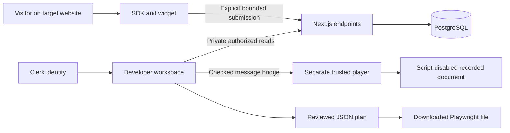

# Architecture: where each responsibility lives

## Explain it in thirty seconds

“A website integrates a small browser SDK. A visitor records and sends a bug. Next.js validates and stores the report in PostgreSQL. The developer signs in to inspect it, views replay through a separate player origin, and reviews a plan before exporting Playwright.”

That is the high-level design, or HLD: the main parts, their boundaries and their data flow. It is not a diagram of every function.

## The system at a glance

The player is a separate process/origin even when it runs on the same machine. PostgreSQL and Clerk are services; they are not browser bundles. The exported file runs later in the developer's environment.

## Concepts you need

**React components** describe UI. State and effects handle interactions and browser lifecycles. React does not by itself provide a database, authorization or report ingestion.

**SSR** means rendering HTML on the server. **Hydration** attaches React behavior to matching server-rendered HTML. Initial client output must agree with the HTML; a timestamp or browser-only branch rendered too early can cause a mismatch. A component marked `'use client'` may still have an initial server-rendered HTML preview. See [React hydration](https://react.dev/reference/react-dom/client/hydrateRoot).

**Server Components** can perform server-side work without sending their component code as browser interaction code. **Client Components** are used for state, effects and browser APIs. Unravel uses server authorization/query boundaries and client feature UI. Browser SDK initialization belongs in an effect, not during rendering. See [Next.js component boundaries](https://nextjs.org/docs/app/getting-started/server-and-client-components).

**Streaming/Suspense** lets one ready section appear while another waits. It changes how waiting is presented; it does not make a slow database query disappear. The workspace can stream project-dependent sections. See [React Suspense](https://react.dev/reference/react/Suspense).

An **origin** is scheme + hostname + port. `http://localhost:3000` and `http://localhost:4201` differ. A URL path such as `/demo` does not create a new origin. This matters for registration, cookies, CORS and replay isolation.

## Stack: what it does and why it fits

These are current technical justifications, not claims that every alternative was benchmarked.

| Tool                     | Role and fit                                                                 | Cost or boundary                                                          |
| ------------------------ | ---------------------------------------------------------------------------- | ------------------------------------------------------------------------- |
| Next.js + React          | Routes, server HTML, persistent layouts and interactive features in one app. | Server/client boundaries, caching and hydration need deliberate handling. |
| TypeScript + Zod schemas | Editor/compiler help plus runtime checks for untrusted data.                 | Types disappear at runtime; schemas still need correct limits/policy.     |
| PostgreSQL               | Relations, constraints, transactions and JSON evidence in one store.         | Large JSON data must stay bounded; storage/connection limits matter.      |
| Drizzle + node-postgres  | Typed query construction, explicit SQL migrations and connection pooling.    | Developers must still understand queries, indexes and transactions.       |
| Clerk                    | Managed developer identity and sign-in UI.                                   | Provider configuration and production lifecycle remain responsibilities.  |
| rrweb recorder/replayer  | Browser DOM capture/reconstruction primitives.                               | Not video; library use does not establish safe or complete replay.        |
| Playwright               | Browser tests and portable generated test files.                             | A locator/assertion still needs review against the target website.        |
| Three.js + GSAP          | Scene rendering and cinematic choreography.                                  | GPU/frame cost requires fallbacks and measurement.                        |
| Motion + CodeMirror      | UI transitions and structured editing.                                       | These enhance UI; they are not the recording/test-generation engine.      |
| pnpm workspaces          | Shared packages, pinned dependencies and root build orchestration.           | Public npm consumption must be tested separately from workspace links.    |

No Redis, message queue, object-storage service, LLM or separate Express backend is required by the current design. Adding one would need a concrete problem and measurements.

## Repository map: important boundaries

For a step-by-step explanation of these folders, major route files and request paths, follow the [code tour](code-tour.md).

| Location                                                | What to find                                                         |
| ------------------------------------------------------- | -------------------------------------------------------------------- |
| [app routes](../../apps/web/src/app)                    | Pages/layouts and thin HTTP handlers.                                |
| [features](../../apps/web/src/features)                 | Workspace, projects, reports, demo and landing behavior.             |
| [server](../../apps/web/src/server)                     | Authentication, bounded request handling, services and repositories. |
| [SDK](../../packages/sdk/src)                           | Browser capture and complete visitor widget.                         |
| [contracts](../../packages/contracts/src)               | Shared runtime shapes/version constraints.                           |
| [test-plan package](../../packages/test-plan/src)       | Pure plan processing and code generation.                            |
| [migrations](../../apps/web/drizzle)                    | SQL and metadata needed to initialize storage.                       |
| [examples](../../examples) / [fixtures](../../fixtures) | Independent integrations versus controlled verification targets.     |

`dist`, `.next`, generated demo bundles and test artifacts are outputs, not places to edit source. Package manifests and lockfiles are required inputs, not clutter.

## Follow the request through the layers

For the question-desk example, the failed website request and the report upload are different HTTP requests. The former is evidence; the latter goes through an ingestion handler, validation/service logic and a repository transaction. A private report read goes through developer authentication and ownership checks before evidence reaches the UI.

This separation keeps HTTP parsing out of SQL, SQL out of React presentation and browser observation out of test generation. It also makes pure logic testable without providers.

## In-app demo versus external SDK integration

Hosted portfolio update: both in-app demos now use the workspace SDK's explicit authenticated same-origin delivery. The separate `/api/demo/ingest/{projectId}` endpoint requires sign-in and ownership. Independent examples still exercise npm 0.1.0. General anonymous intake remains disabled on the hosted portfolio; earlier published-demo verification describes the prior configuration.

The Next demo renders an ordinary route. The React demo serves a separate React document built from source, without the Next client runtime. They share scenario components and use the published SDK through a package alias. Independent example packages also install the actual npm package outside the workspace.

The hub checks the signed-in developer's project and uses the current origin. An ordinary external developer instead configures that public project ID once; their visitors need no Unravel login.

## Code stops and teach-back

Open the [workspace layout](<../../apps/web/src/app/(product)/app/layout.tsx>), [demo recorder](../../apps/web/src/features/demo/DemoRecorder.tsx) and [public SDK entry](../../packages/sdk/src/index.ts). Locate authorization, effect cleanup and the public API respectively.

Explain aloud: Why can the SDK be imported during SSR but not initialized there? Why is the replay player separate? Which code runs when a report is downloaded versus when the exported test executes?
