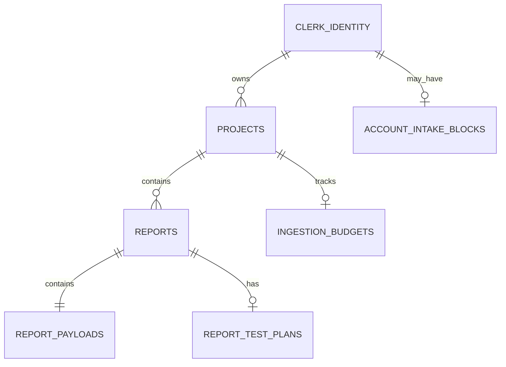

# Database and backend

## Start with the model

A developer owns projects. A project groups reports for one registered website origin. A report has searchable metadata, heavier evidence and an optional saved test plan. Clerk manages identities; Unravel does not store account passwords.

A **primary key** uniquely identifies a row. A **foreign key** connects it to another row. A **constraint** rejects invalid database states even if application code makes a mistake.

## Schema at a glance

`CLERK_IDENTITY` is external, not a seventh application table or SQL foreign key. `owner_id` is Clerk's stable subject. Ownership is checked in queries.

## The six tables

| Table                   | Important fields                                                                                                                  | Why it exists                                               |
| ----------------------- | --------------------------------------------------------------------------------------------------------------------------------- | ----------------------------------------------------------- |
| `projects`              | `id`, `owner_id`, `name`, `origin`, `created_at`                                                                                  | Destination, owner and exact registered website origin.     |
| `reports`               | `id`, `project_id`, `recording_id`, title/description, status/revision, digest, bytes/event count, recording metadata, timestamps | Searchable report record and submission identity.           |
| `report_payloads`       | `report_id`, `replay`, `events`                                                                                                   | Heavy DOM and semantic evidence, fetched separately.        |
| `report_test_plans`     | `report_id`, `plan`, `revision`, `updated_at`                                                                                     | Latest reviewed/editable plan, not the original recording.  |
| `ingestion_budgets`     | `project_id`, minute/day buckets and counters                                                                                     | Shared submission-attempt limits across app instances.      |
| `account_intake_blocks` | `owner_id`, `received_at`                                                                                                         | Minimal record preventing new intake after account closure. |

`JSONB` is PostgreSQL's structured JSON storage. It fits variable event arrays and versioned plans; stable relationships and searchable fields still use ordinary columns. This is not a design that stores everything in one unvalidated JSON object.

Reports reference projects. Payloads/plans reference reports, and their foreign keys cascade on deletion. The schema provides the relationship; the ingestion transaction ensures a newly accepted report also gets its payload. An account-intake block does not itself erase old reports or provider backups.

## Constraints and indexes

- Unique `(owner_id, origin)` prevents duplicate origin registrations for the same developer.
- Unique `(project_id, recording_id)` protects retry identity.
- Project/created-time and project/status/created-time indexes support collection queries.
- Checks restrict statuses, positive revisions, text lengths and report bytes.

An **index** helps locate rows without examining the entire table for every query, but costs space and work on writes. These indexes reflect real query patterns. Ordinary substring search with `ILIKE '%text%'` is not magically accelerated by every B-tree index; a different search index should follow measured need.

Lists select report metadata rather than replay arrays. This avoids loading a large payload just to display a report title. The list query combines count, clamped pagination and rows in one statement so they share a statement snapshot and avoid extra remote round trips. It is not a claim that every transaction uses serializable isolation; see [PostgreSQL isolation](https://www.postgresql.org/docs/current/transaction-iso.html).

## From HTTP to persistence

| Boundary           | Responsibility                                                            |
| ------------------ | ------------------------------------------------------------------------- |
| Route Handler      | Method, headers, request size/type, response shape and error translation. |
| Runtime validation | Parse unknown JSON and enforce bounded supported evidence.                |
| Service            | Registration, ownership and business rules.                               |
| Repository         | Queries, constraints, transactions and conditional updates.               |

An API identifier is not authorization. Private list/detail/replay/plan/export calls authenticate the developer and constrain the project owner. Foreign and missing resources are deliberately hard to distinguish. The browser hiding a button would not provide this protection.

Public ingestion is different: the visitor need not sign in. Its registered `Origin` is checked, but a non-browser caller can forge that header. Therefore CORS/registration alone cannot prevent abuse. Bounded reads, database budgets, storage caps and production edge controls serve different purposes.

## Why retry does not create two reports

**Idempotent** means repeating an operation with the same identity/input does not create an additional effect here.

Suppose PostgreSQL commits a report, but the response never reaches the visitor:

1. The SDK freezes the initial submitted body and recording ID.
2. A retry sends that same envelope.
3. The service validates it and computes a SHA-256 digest of its canonical JSON representation.
4. The repository transaction locks the project row, rechecks registration/intake status and looks for that project/recording pair.
5. Matching digest: return the existing report ID. Different digest: 409 conflict.
6. A new report's metadata and payload are inserted in the same transaction; a unique constraint also protects the recording pair.

A **transaction** makes the related inserts commit together or roll back together. The digest is a content comparison, not encryption or proof that the visitor consented. Project locking simplifies concurrent storage checks but also serializes that project's ingestion work: a deliberate simplicity/throughput tradeoff.

The guarantee is scoped to a retained recording identity. After owner deletion, re-submission can create a report again. Repeated attempts may also count toward admission limits. “Exactly once under every possible failure” would overstate the implementation.

## Editing without silent overwrites

**Optimistic concurrency** checks a version when saving instead of holding a lock while the user edits.

For example, two tabs load plan revision 3. Tab A saves with expected revision 3; the server updates it to 4. Tab B's update requiring revision 3 matches no row and returns 409. It must reload/recover deliberately instead of overwriting A's work.

A generated unsaved plan starts with revision 0; the first save uses insert-on-conflict handling. Report metadata also has revisions. Project settings use an expected snapshot of the previous settings. These are related strategies, not one universal shared revision field.

Original replay/events are not rewritten when the developer edits a plan. The plan is the interpretation used for the test; the recording remains evidence of what was observed.

## Limits, deletion and migrations

Current repository limits include 30 attempts/minute and 200/day per project; storage admission caps reports/count/bytes separately. Read the implementation before quoting a number because limits can change. These controls do not replace edge size/rate/concurrency protections before public hosting.

Owner deletion cascades through the related application rows. There is no selected automatic expiry policy. Signed account-deletion handling blocks future intake; production webhook delivery and backup/retention behavior require separate verification.

Migrations are ordered SQL changes plus Drizzle metadata/journal. They must initialize a new database without the original developer's data. The guarded migration script checks the application/migration URLs target the same database. Connection checking covers all six tables; this alone is not proof that a fresh database successfully migrated. That clean-service test is still pending.

## Code stops and teach-back

- [Schema](../../apps/web/src/server/db/schema.ts): locate each relationship and unique constraint.
- [Report repository](../../apps/web/src/server/reports/repository.ts): trace `insert`, `list` and `consume`.
- [Plan persistence](../../apps/web/src/server/reports/plans.ts): explain revision 0 versus a saved revision.
- [Request boundaries](../../apps/web/src/server/http.ts): inspect bounded body handling.

Explain: Why split payloads? What if a commit succeeds but its HTTP response is lost? What exactly prevents a stale tab from winning? Why is checking six table names weaker than testing all migrations from empty?
