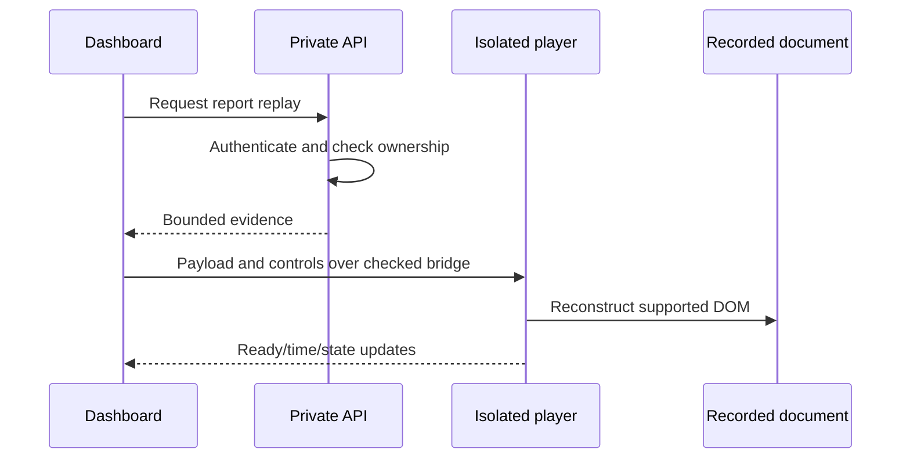

# Replay and test generation

## Two different outputs from the same evidence

Replay asks **“What did the recorded page do?”** A test asks **“Can I perform these actions again, and what should happen?”** They share evidence but need different representations. A DOM mutation is useful for replay without necessarily being a user action worth exporting.

## Why the recorded page cannot simply run again

Recorded HTML/attributes are untrusted. Executing original scripts could make requests, submit forms or affect the viewer. The recorded page also does not necessarily have the same resources, authentication or backend state as the original.

A **sandbox** restricts what embedded content can do. Unravel uses two nested boundaries:

1. The dashboard embeds a trusted player on a different origin.
2. The player uses an inner recorded-document frame with scripts/forms disabled.

The trusted player needs JavaScript to operate rrweb. That does not mean the recorded document receives the same permission. The outer player can use its script/same-origin permissions because it is not on the dashboard origin; moving it onto that origin would undermine the intended separation.

The server validates the accepted inert replay representation. CSP further restricts resources, connections, forms and embedding. The player serves fixed trusted files, not arbitrary uploaded HTML or a private report-reading API. It receives no Clerk/database keys.

## How evidence reaches the player



`postMessage` is a browser mechanism for communicating between windows. A received message is not trusted merely because it has a familiar field name. The bridge checks exact origin, source window and a per-mount channel, and sends to explicit target origins. The player's allowed parents are configured separately.

The viewer correlates playback time with timeline events. Selecting evidence can seek the player; filters alter the visible timeline, not the original recording. Player failure should leave the evidence usable and provide recovery rather than erase the whole report view.

## Fidelity and recovery limits

Only a restricted DOM/CSS representation is reconstructed. Original JavaScript, external assets/stylesheets/fonts, canvas, Shadow DOM, complex controls and cross-origin frames are not universally reproduced. Masks cannot later be undone.

“Replay ready” means the supported player initialized, not that every original pixel or feature was reproduced perfectly. Test native dialogs, disclosure elements, dynamic dimensions and both privacy modes explicitly; a simple static form is insufficient evidence of broad fidelity.

## From semantic events to a plan

The generator is deterministic: the same supported input produces the same generated representation under the same code version. There is no LLM call inferring behavior.

The central JSON plan contains an initial path, included/excluded steps, locators, values, notes, assertions and an expected-behavior confirmation flag. It is framework-independent; the initial export adapter targets Playwright.

**Normalization** removes repetition that would make a reproduction wrong or noisy:

| Raw evidence                                                         | Plan interpretation                                                   |
| -------------------------------------------------------------------- | --------------------------------------------------------------------- |
| Click to focus an input, then several fills of that identified input | Latest meaningful fill.                                               |
| Click a submit control followed quickly by its submit event          | Avoid repeating the same submission.                                  |
| Click followed by a recent same-site SPA transition                  | Treat that transition as resulting evidence in the bounded heuristic. |
| Standalone/back navigation                                           | Keep an appropriate navigation step.                                  |
| Unknown target or masked value                                       | Flag for review; do not invent a selector/value.                      |

The causal SPA heuristic is bounded to 2.5 seconds and excludes pop navigation. Click/submit folding has a shorter 250 ms window. These are heuristics, not proof of causality. Unknown targets are not merged merely because they are both unknown.

More than 100 normalized steps produces a reviewable unsupported marker rather than silently exporting a truncated action list. Raw evidence is never rewritten by normalization or the editor.

## Locators, safe values and expected results

A **locator** identifies a target, such as a CSS path or an explicitly allowed test ID. A path can be valid CSS and still match no element, several elements or the wrong element after a redesign. Export validation checks allowed syntax; executing against the target checks its actual behavior.

Masked values must be replaced with safe synthetic inputs. Do not restore real credentials just to make a test convenient. Multiple selections need a collection of selected values, not an accidental single string. Unsupported steps must be fixed or deliberately excluded.

An **assertion** states what correctness looks like. In the question example:

```ts
await page.getByLabel('Your question', { exact: true }).fill('Synthetic question');
await page.getByRole('button', { name: 'Submit question', exact: true }).click();
await expect(
  page.getByText('Your question was submitted successfully.', {
    exact: true,
  }),
).toBeVisible();
```

This is an illustrative reviewed test fragment, not a literal generated file or proof of a fixed endpoint. It needs Playwright imports/baseURL and a target satisfying those locators. Asserting that the broken error appears would reproduce the failure, not verify the intended fix.

## Reproduction versus regression

**Reproduction mode** repeats reviewed actions without claiming correctness. **Regression mode** also needs developer-confirmed intended assertions. Supported checks include text, visibility, URL, response and page-error conditions, subject to validation.

A response assertion subscribes before its selected action and matches relevant new requests. It must not accidentally accept an earlier response. A successful status alone may not establish that the business action succeeded. Likewise, “no page errors” does not prove a question was saved; caught/network failures may not be uncaught exceptions.

The editor keeps readable steps, JSON and generated code connected. Changes are saved with revision checking. Existing plan versions are handled through schema parsing/compatibility behavior; do not equate a JSON schema upgrade with rewriting original evidence or a SQL migration.

The export endpoint is private and validates the saved plan for the requested mode. The UI saves applied changes as part of download. The file imports Playwright, uses condition-based operations/assertions and is executed by the developer. It does not contain a server-side browser session or automatically obtain target-site authentication.

## What a convincing proof looks like

1. Download the actual reviewed regression file.
2. Run it against the buggy target: it must fail at the intended assertion, not an unrelated locator/setup error.
3. Fix the target behavior.
4. Run the unchanged file: it should pass.
5. Compare file hashes and record retries/any manual locator corrections.

Separate this from reproduction-only execution and from a future hosted deployment. A text/visibility check also does not automatically detect every visual clipping defect; choose assertions appropriate to the bug.

## Code stops and teach-back

- [Viewer and timeline](../../apps/web/src/features/reports/ReportViewer.tsx), [origin validation](../../apps/web/src/features/reports/replay-origin.ts), [player host](../../scripts/replay-host.mjs).
- [Normalization](../../packages/test-plan/src/normalization.ts), [schema](../../packages/test-plan/src/schema.ts), [validation](../../packages/test-plan/src/validation.ts), [Playwright adapter](../../packages/test-plan/src/playwright.ts).
- [Plan editor](../../apps/web/src/features/reports/PlanEditor.tsx), [private plan persistence/export](../../apps/web/src/server/reports/plans.ts).

Explain: Which frame can execute trusted scripts? Why can a locator pass export validation and still fail at runtime? Why must the developer define expected behavior? What evidence distinguishes a useful regression test from a test that merely repeats clicks?
